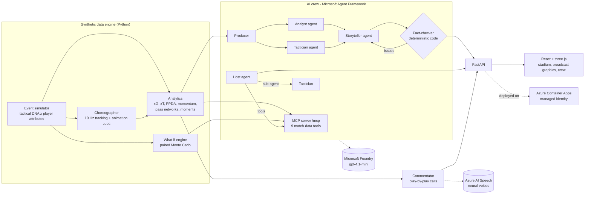

# MatchMind - the AI match crew that explains *why* and simulates *what if*

**Inside the Game: Developer Hackathon (Microsoft x Premier League) entry - "The Synthetic Match Insights Engine for Premier League Studio".**

Live demo: **https://matchmind.blackisland-4799a434.japaneast.azurecontainerapps.io/**
Demo video (1:55): **https://youtu.be/aOTA-lcrBrU**

MatchMind turns a stream of synthetic, football-realistic match data into a **broadcast you can trust**:
a 3D miniature stadium where every match plays out, a live commentator who calls the action in a neural voice,
an AI crew that explains each key moment for the viewer in front of it (casual fan, analyst, child, coach, or audio
description for blind and low-vision fans) in 10 languages, a full-time report with social posts, a chat where you
can ask the crew anything - and a **What-if Lab** that answers "what if they had pressed higher from the 60th
minute?" by re-simulating the rest of the match hundreds of times.

Every number, name, minute, scoreline and formation the AI says is **checked against the data by deterministic code
before anyone sees it**. Drafts that fail go back to the writer with the exact problems; if they still fail, the
viewer gets a verified template instead. Nothing unverified reaches the screen.

> All teams, players and matches are synthetic. No real league data, footage or trademarks are used.

---

## What it does

| Feature | What you see | How it works |
|---|---|---|
| **Matchday Miniature** | Every match plays in a 3D stadium: human-shaped footballers (knees, elbows, a real running stride) who dribble, sprint, slide in and go down, a ball in flight, a crowd you hear rise for chances and see celebrate goals, AR pass/shot arcs and name/speed tags in the scene | three.js with every body part instanced across all players, driven by the choreographer's 10 Hz tracking and animation cues (kicks, tackles, slides, falls, dives); poses rest on the grass at their lowest point |
| **TV direction** | The AI director cuts between TV, follow, tactical and goal cameras, circles the scorer and his team-mates after a goal, then shows the goal again in slow motion; after a foul you see the challenge replayed from a low side camera and cut back as the free kick is taken | Shot, goal and foul events drive camera "shots" and replays (`frontend/src/lib/reel.ts`); a stinger and the camera's name mark every cut |
| **Front-page trailer** | Every goal of a featured match on a loop: the build-up from several angles, the celebration, two replays | The same director, scripted around each goal |
| **Live commentator** | Play-by-play in a neural voice - "Okafor shoots... saved by Osei!" - and after big moments the crew's verified analysis read out, in the viewer's language | 28 kinds of call built from the events only (`commentary.py`), picked by priority as play runs, spoken by **Azure AI Speech** neural voices (`voice.py`); the crowd ducks under the voice |
| **Live crew** | Key moments appear as the match runs, with clickable `▶ 37'` evidence chips that replay the build-up in 3D | Moment detector -> Agent Framework workflow (Analyst ∥ Tactician -> Storyteller -> Fact-checker loop) |
| **10 languages, whole site** | One button switches the interface (incl. right-to-left Arabic), every story, answer, report and the commentator's voice | Interface and commentary calls translated by the Foundry model (`scripts/translate_ui.py`, `scripts/translate_commentary.py`); stories pre-written and verified in every language for the featured matches |
| **5 audiences x 10 languages** | The same goal explained for a fan, an analyst, an 8-12 year-old, a coach, or as audio description | Persona + language brief to the Storyteller |
| **Ask the crew** | "Who ran the most?" "Why did they concede?" "What if Ironvale pressed higher?" | Host agent calling 9 match-data tools (in-process or via the **MCP server**), consulting a Tactician sub-agent, answer fact-checked against every tool result |
| **What-if Lab** | Win/draw/loss and xG for the rest of the match, as played vs. with your tactical change, with a 95% interval and a verdict | Deterministic replay to minute M, then paired Monte Carlo with common random numbers (2 x 200 simulations in ~10 s) |
| **Stats** | xG, possession, field tilt, PPDA, high turnovers, xG race chart, player table with tracking metrics, pass networks | Deterministic analytics over events + 10 Hz tracking |
| **Report** | Headline, report that opens with the final score, three social posts, all with evidence chips | Same crew workflow with a full-match fact packet |
| **Scenario Lab** | Pick two clubs and the home coach's plan (minute, formation, pressing) and a brand-new match is simulated for you | Simulator + choreographer + analytics in ~10 s |
| **Studio overlay** | Broadcast lower thirds for a studio or stream | `#/studio/<match>` page fed by the same verified crew |
| **Agent trace** | Every story has a "How the crew did it" button: each agent's output, timings, tool calls, and fact-checker rejections | Trace collected by workflow executors and function middleware |

## Architecture



### Microsoft technologies

| Technology | Where |
|---|---|
| **Microsoft Agent Framework** (`agent-framework-core` 1.21) | `backend/matchmind/ai/crew.py` - `Agent`s, a `WorkflowBuilder` graph with fan-out/fan-in and a revision loop, agent-as-tool (`as_tool`), function middleware capturing tool results |
| **Microsoft Foundry** | `gpt-4.1-mini` deployment (Global Standard) on an AI Services resource; `FoundryChatClient` or Azure OpenAI client (`backend/matchmind/ai/llm.py`) |
| **Azure AI Speech** | Neural text-to-speech for the commentator through the same Foundry resource (`backend/matchmind/voice.py`): `en-GB-RyanNeural` and a native voice for each of the other 9 languages; keyless with an Entra token |
| **Model Context Protocol** | `backend/matchmind/mcp_server.py` - streamable-HTTP MCP server at `/mcp`, used by the Host agent via `MCPStreamableHTTPTool` and usable from GitHub Copilot agent mode or Foundry agents |
| **Azure Container Apps** | One container (API + web app + MCP) on a WorkloadProfiles environment with Log Analytics; system-assigned managed identity with *AcrPull*, *Cognitive Services OpenAI User* and *Cognitive Services Speech User* - no keys or passwords in production |
| **GitHub** | Source, CI (tests, the featured matches, a calibration report and the web build on every push), GitHub Copilot during development |

## The synthetic data

No dataset is provided by the hackathon, so MatchMind generates its own - and the generator is a feature in itself.

- **Fictional league**: 6 clubs, 96 players, each club with a formation and six tactical dials (press, tempo,
  directness, width, defensive-line height, counter-attack urge) and players with attributes.
- **Event simulator** (`engine/sim.py`): the player on the ball chooses passes, carries, crosses, through balls and
  shots with probabilities shaped by location, opponent pressure, both teams' DNA and player skill. It produces
  turnovers, set pieces, fouls, cards, penalties, substitutions, and coaches who react to the score ("chasing the
  game", "protecting the lead"). ~40 ms per match.
- **Choreographer** (`engine/choreo.py`): plays the event script out as continuous football at 10 Hz.
  - The player on the ball never stands still: he runs into open grass, goes past or away from a close marker,
    shields when tight and cuts inside near the byline; dribbles knock the ball ahead and catch up with it.
  - Passes are released when the ball would arrive on time from where the carrier really is, at real ball speeds,
    aimed where the receiver will be; the team shape follows the real ball.
  - The nearest defender presses, interceptors step into the passing lane, tacklers chase the dribbler; before a foul
    the ball reaches the man who is fouled and the fouler closes him down, so the player on the ball is the one who
    goes down.
  - Dead balls are restarted like real football: the ball is put back on the spot and the taker walks over; free kicks
    are taken where the foul was. The scorer runs off to celebrate and team-mates pile on.
  - Event positions are then rewritten from what actually happened, so stats, AI commentary and the 3D replay
    describe the same match. `scripts/motion_check.py` measures it.
- **Calibrated against real top-flight averages** (`scripts/calibrate.py`, 400 matches; movement from the three
  featured matches):

| Per team per match | MatchMind | Real top flight |
|---|---|---|
| Shots | 13.7 | ~12-13 |
| Shots on target | 4.8 | ~4.5 |
| xG | 1.61 | ~1.3-1.5 |
| Goals | 1.68 | ~1.4 |
| Pass accuracy | 79.9% | ~80-86% |
| Fouls / yellow cards | 11.2 / 1.7 | ~10-11 / ~1.8 |
| Corners / offsides | 5.3 / 2.3 | ~5 / ~2 |
| Match length | 96.7 min | ~96-98 min |
| Distance per player (full match) | 9.4-10.9 km | ~10-11 km |
| Top speed | 28-29 km/h | ~28-34 km/h |
| Ball speed in flight (median) | 16 m/s | ~15-20 m/s |

- **Featured matches** are chosen by a drama score (goals, lead changes, comebacks, late goals, red cards) over 400
  seeds per fixture.

## Why you can trust what it says

1. **Fact packets.** Agents never see the raw match; they get a compact packet of verified facts with event ids.
   A goal's packet states the score before and after and what the goal did ("puts them ahead: 3-2").
2. **Deterministic fact-checker** (`ai/verifier.py`): every number (with rounding and % conversion), minute, scoreline
   (must equal a real score), formation, player name (checked against the whole league, so a real name from another
   team is caught) and evidence tag must trace back to the packet or to tool results. Match reports must state the
   final score. Replay links the facts do not back are removed and the text is checked again.
3. **Revision loop**: rejected drafts go back to the Storyteller with the exact issues (max 2 drafts).
4. **Safe fallback**: if the AI still fails, or the model is unavailable, the viewer gets template narration that is
   built from the same packet and always verifies. The app works fully with no model at all.
5. **Statistical honesty** in what-ifs: the verdict is "no clear effect" unless the 95% interval for the change in
   expected points excludes zero, and the crew is told not to overstate it.
6. **Checked in production**: `scripts/live_check.py <match>` tests the deployed site - goal stories (scorer and
   score), stories in four scripts, the analyst version, the report's final score, Ask answers, the what-if
   explanation and the commentator's goal calls - against the match's own facts.

## Run it locally

```bash
python -m venv .venv
.venv/Scripts/pip install -r backend/requirements.txt          # macOS/Linux: .venv/bin/pip
cd backend && ../.venv/Scripts/python scripts/generate_showcase.py --fixed
../.venv/Scripts/python -m uvicorn matchmind.api:app --port 8765
```

```bash
cd frontend && npm ci && npm run build      # served by the API at http://localhost:8765
# or: npm run dev  (http://localhost:5173, proxies /api and /mcp)
```

Without a model the app runs in verified **template mode** (the commentator falls back to the browser's voice). To
enable the AI crew and the neural voice, copy `backend/.env.example` to `backend/.env` and set a Microsoft Foundry
endpoint (Entra ID via `az login`, or a key for local development).

Tests: `cd backend && ../.venv/Scripts/python -m pytest -q` (verifier, templates, what-if, and the full crew workflow
with a scripted chat client).

### Use the MCP server from another client

```json
{ "servers": { "matchmind": { "type": "http", "url": "https://<your-app>/mcp/" } } }
```

Tools: `match_overview`, `get_moment`, `get_team_stats`, `get_player_stats`, `top_players`, `find_events`,
`explain_possession`, `momentum_phases`, `simulate_what_if`.

## Deploy to Azure

```bash
az login
LOCATION=japaneast bash infra/deploy.sh      # Docker must be running
```

Creates the resource group, a Microsoft Foundry (AI Services) resource with a `gpt-4.1-mini` deployment, an Azure
Container Registry, a WorkloadProfiles Container Apps environment (Log Analytics attached) and the app. The app's
system-assigned managed identity pulls the image (*AcrPull*), calls the model (*Cognitive Services OpenAI User*) and
the voice (*Cognitive Services Speech User*, with `AZURE_SPEECH_RESOURCE_ID` and `AZURE_SPEECH_REGION` set on the app)
- there are no registry passwords or keys anywhere in production. The image is built locally and pushed, because ACR
cloud builds are not available on Azure for Students subscriptions.

## Cost controls

- Featured matches ship with **pre-generated, pre-verified** stories and reports in every language
  (`backend/precomputed/`), keyed by a fingerprint of the facts, so viewing them costs nothing and a story can never
  be served for facts that have changed.
- New AI output is cached on disk; each voice line is synthesised once and cached.
- Per-client rate limits on model-backed and voice endpoints; `gpt-4.1-mini` keeps a typical story under $0.003.

## Repository map

```
backend/matchmind/engine/       simulator, choreographer (10 Hz tracking + animation cues), formations, league, pitch models
backend/matchmind/analytics/    team/player stats, momentum, pass networks, key-moment detection
backend/matchmind/ai/           crew workflow, fact-checker, fact packets, personas, templates, model clients
backend/matchmind/commentary.py play-by-play calls (+ commentary_i18n.json, 10 languages)
backend/matchmind/voice.py      Azure AI Speech neural voice, keyless, cached
backend/matchmind/tools.py      match-data tools (shared by agents and the MCP server)
backend/matchmind/whatif.py     paired Monte Carlo what-if engine
backend/matchmind/api.py        FastAPI app, MCP mount, caching, rate limiting
backend/scripts/                showcase matches, calibration, motion check, precompute, translations, live check
frontend/src/scene/Stadium.ts   the three.js stadium: figures, poses, cameras, replays
frontend/src/lib/               playback clock, tracking store, reel and TV director, commentator, sound
frontend/src/                   React + TypeScript app (broadcast graphics, crew panels, scenario lab)
infra/deploy.sh                 Azure provisioning
```
