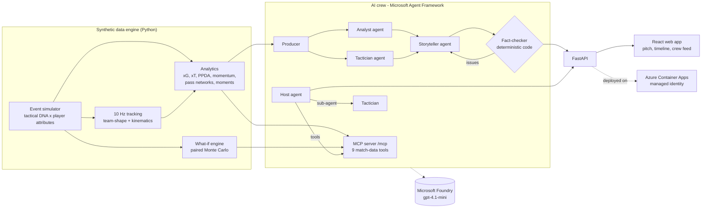

# MatchMind - the AI match crew that explains *why* and simulates *what if*

**Inside the Game: Developer Hackathon (Microsoft x Premier League) entry.**

MatchMind turns a stream of synthetic, football-realistic match data into **explainable match intelligence**:
live commentary for each key moment, written for the viewer in front of it (casual fan, analyst, child, coach, or
audio description for blind and low-vision fans) in 10 languages, a full-time recap with social posts, a chat where
you can ask the crew anything - and a **What-if Lab** that answers "what if they had pressed higher from the 60th
minute?" by re-simulating the rest of the match hundreds of times.

Every number, name, minute, scoreline and formation the AI says is **checked against the data by deterministic code
before anyone sees it**. Drafts that fail go back to the writer with the exact problems; if they still fail, the
viewer gets a verified template instead. Nothing unverified reaches the screen.

> All teams, players and matches are synthetic. No real league data, footage or trademarks are used.

---

## What it does

| Feature | What you see | How it works |
|---|---|---|
| **Matchday Miniature** | Every match plays in a living 3D tabletop stadium: kitted footballers whose strides match their real speed, a ball that flies in arcs, a crowd that celebrates, AR pass/shot arcs and name/speed tags drawn into the scene | three.js (instanced figures, tilt-shift focused on the ball), driven by the event-anchored 10 Hz tracking; adaptive quality and off-screen pausing keep it smooth |
| **AI director** | The camera cuts to the goal for big chances, circles the scorer after a goal, follows play like TV - or pick TV, Tactical, Goal cam, Follow | Shot and goal events drive camera "shots"; broadcast graphics (score bug, lower thirds, GOAL takeover) react to the same events |
| **Live crew** | Key moments appear as the replay runs, with clickable `▶ 37'` evidence chips that replay the build-up in 3D | Moment detector -> Agent Framework workflow (Analyst ∥ Tactician -> Storyteller -> Fact-checker loop) |
| **10 languages, whole site** | One "Commentary" button switches the interface (incl. right-to-left Arabic) and every story, answer and report | Interface strings translated by the Foundry model (`scripts/translate_ui.py`); commentary pre-written and verified in every language for the featured matches |
| **5 audiences x 10 languages** | The same goal explained for a fan, an analyst, an 8-year-old, a coach, or as spoken audio description | Persona + language brief to the Storyteller; browser speech for "Listen" |
| **Ask the crew** | "Who ran the most?" "Why did they concede?" "What if Ironvale pressed higher?" | Host agent calling 9 match-data tools (in-process or via the **MCP server**), consulting a Tactician sub-agent, answer fact-checked against every tool result |
| **What-if Lab** | Win/draw/loss and xG for the rest of the match, as played vs. with your tactical change, with a 95% interval and a verdict | Deterministic replay to minute M, then paired Monte Carlo with common random numbers (2 x 200 simulations in ~5 s) |
| **Stats** | xG, possession, field tilt, PPDA, high turnovers, xG race chart, player table with tracking metrics, pass networks | Deterministic analytics over events + 10 Hz tracking |
| **Recap** | Headline, 150-word report, three social posts, all with evidence chips | Same crew workflow with a full-match fact packet |
| **Scenario Lab** | Generate a brand-new match between any two clubs, optionally with a scripted tactical switch | Simulator + tracking + analytics in ~10 s |
| **Agent trace** | Every story has an "Agent trace" button: each agent's output, timings, MCP/tool calls, and fact-checker rejections | Trace collected by workflow executors and function middleware |

## Architecture



### Microsoft technologies

| Technology | Where |
|---|---|
| **Microsoft Agent Framework** (`agent-framework-core` 1.21) | `backend/matchmind/ai/crew.py` - `Agent`s, a `WorkflowBuilder` graph with fan-out/fan-in and a revision loop, agent-as-tool (`as_tool`), function middleware capturing tool results |
| **Microsoft Foundry** | `gpt-4.1-mini` deployment (Global Standard) on an AI Services resource; `FoundryChatClient` or Azure OpenAI client (`backend/matchmind/ai/llm.py`) |
| **Model Context Protocol** | `backend/matchmind/mcp_server.py` - streamable-HTTP MCP server at `/mcp`, used by the Host agent via `MCPStreamableHTTPTool` and usable from GitHub Copilot agent mode or Foundry agents |
| **Azure Container Apps** | Single container (API + web app + MCP), built in the cloud from the `Dockerfile` with `az containerapp up`, system-assigned managed identity with *Cognitive Services OpenAI User* - no keys in production |
| **GitHub** | Source, CI tests, and GitHub Copilot used during development |

## The synthetic data

No dataset is provided by the hackathon, so MatchMind generates its own - and the generator is a feature in itself.

- **Fictional league**: 6 clubs, 96 players, each club with a formation and six tactical dials (press, tempo,
  directness, width, defensive-line height, counter-attack urge) and players with attributes.
- **Event simulator** (`engine/sim.py`): the player on the ball chooses passes, carries, crosses, through balls and
  shots with probabilities shaped by location, opponent pressure, both teams' DNA and player skill. It produces
  turnovers, set pieces, fouls, cards, penalties, substitutions, and coaches who react to the score ("chasing the
  game", "protecting the lead"). ~40 ms per match.
- **Tracking** (`engine/tracking.py`): 10 Hz positions for 22 players and the ball, from a team-shape model with
  lagged ball perception, pressing runs, receivers running onto passes, and pace/acceleration limits.
- **Calibrated against real top-flight averages** (`scripts/calibrate.py`, 400 matches):

| Per team per match | MatchMind | Real top flight |
|---|---|---|
| Shots | 13.7 | ~12-13 |
| Shots on target | 4.8 | ~4.5 |
| xG | 1.61 | ~1.3-1.5 |
| Goals | 1.68 | ~1.4 |
| Pass accuracy | 79.9% | ~80-86% |
| Fouls / yellow cards | 11.2 / 1.7 | ~10-11 / ~1.8 |
| Corners / offsides | 5.3 / 2.3 | ~5 / ~2 |
| Match length | 96.7 min | ~96-98 min |
| Distance per outfield player | ~10-11 km | ~10-11 km |
| Top speed | 27-32 km/h | ~28-34 km/h |

- **Featured matches** are chosen by a drama score (goals, lead changes, comebacks, late goals, red cards) over 400
  seeds per fixture.

## Why you can trust what it says

1. **Fact packets.** Agents never see the raw match; they get a compact packet of verified facts with event ids.
2. **Deterministic fact-checker** (`ai/verifier.py`): every number (with rounding and % conversion), minute, scoreline
   (must equal a real score), formation, player name (checked against the whole league, so a real name from another
   team is caught) and evidence tag must trace back to the packet or to tool results.
3. **Revision loop**: rejected drafts go back to the Storyteller with the exact issues (max 2 drafts).
4. **Safe fallback**: if the AI still fails, or the model is unavailable, the viewer gets template narration that is
   built from the same packet and always verifies. The app works fully with no model at all.
5. **Statistical honesty** in what-ifs: the verdict is "no clear effect" unless the 95% interval for the change in
   expected points excludes zero, and the crew is told not to overstate it.

## Run it locally

```bash
python -m venv .venv
.venv/Scripts/pip install -r backend/requirements.txt          # macOS/Linux: .venv/bin/pip
cd backend && ../.venv/Scripts/python scripts/generate_showcase.py --fixed
../.venv/Scripts/python -m uvicorn matchmind.api:app --port 8765
```

```bash
cd frontend && npm ci && npm run build      # served by the API at http://localhost:8765
# or: npm run dev  (http://localhost:5173, proxies /api and /mcp)
```

Without a model the app runs in verified **template mode**. To enable the AI crew, copy `backend/.env.example` to
`backend/.env` and set a Microsoft Foundry endpoint (Entra ID via `az login`, or a key for local development).

Tests: `cd backend && ../.venv/Scripts/python -m pytest -q` (verifier, templates, what-if, and the full crew workflow
with a scripted chat client).

### Use the MCP server from another client

```json
{ "servers": { "matchmind": { "type": "http", "url": "https://<your-app>/mcp/" } } }
```

Tools: `match_overview`, `get_moment`, `get_team_stats`, `get_player_stats`, `top_players`, `find_events`,
`explain_possession`, `momentum_phases`, `simulate_what_if`.

## Deploy to Azure

Live demo: **https://matchmind.blackisland-4799a434.japaneast.azurecontainerapps.io/**
(MCP endpoint: `/mcp/`)

```bash
az login
LOCATION=japaneast bash infra/deploy.sh      # Docker must be running
```

Creates the resource group, a Microsoft Foundry (AI Services) resource with a `gpt-4.1-mini` deployment, an Azure
Container Registry, a WorkloadProfiles Container Apps environment (Log Analytics attached) and the app. The app's
system-assigned managed identity pulls the image (*AcrPull*) and calls the model (*Cognitive Services OpenAI User*) -
there are no registry passwords or model keys anywhere in production. The image is built locally and pushed, because
ACR cloud builds are not available on Azure for Students subscriptions.

## Cost controls

- Featured matches ship with **pre-generated, pre-verified** commentary (`backend/precomputed/`), so viewing them
  costs nothing.
- New AI output is cached on disk by (match, moment, audience, language, model).
- Per-client rate limit on model-backed endpoints; `gpt-4.1-mini` keeps a typical moment story under $0.003.

## Repository map

```
backend/matchmind/engine/     simulator, formations, league, pitch models, tracking
backend/matchmind/analytics/  team/player stats, momentum, pass networks, key-moment detection
backend/matchmind/ai/         crew workflow, fact-checker, fact packets, personas, templates, model clients
backend/matchmind/tools.py    match-data tools (shared by agents and the MCP server)
backend/matchmind/whatif.py   paired Monte Carlo what-if engine
backend/matchmind/api.py      FastAPI app, MCP mount, caching, rate limiting
frontend/src/                 React + TypeScript app (canvas pitch, timeline, crew panels)
infra/deploy.sh               Azure provisioning
```
